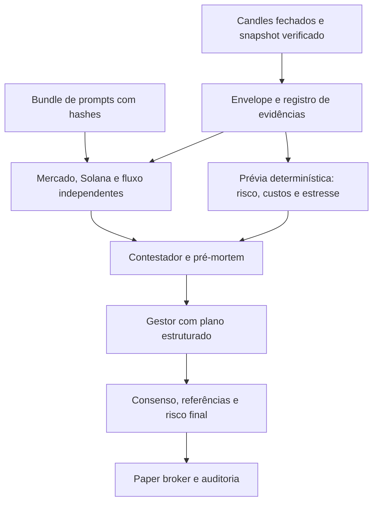

# Arquitetura do Alladin

Alladin é um backend Python de análise e paper trading para Solana mainnet. O servidor expõe comandos JSON por HTTP autenticado e MCP stdio. Não tem interface gráfica, não se conecta à Phantom/OKX, não carrega assinante e não envia transações.

## Caminho de mercado paper

1. `CoinbaseMarket` coleta candles fechados do produto SOL-USDC, o livro, trades recentes e volume de 24 horas pelos endpoints públicos Coinbase Advanced Trade.
2. O provedor recusa candles abertos, lacunas, produtos que não sejam SOL e snapshots sem bid/ask ou dados de trade válidos.
3. `SolanaRPC` verifica mainnet e os dados SPL do mint por métodos de leitura.
4. O motor calcula features e estratégias, o conselho escolhe LONG/HOLD/CLOSE e o risco determina se há aprovação e tamanho.
5. `PaperBroker` atualiza a carteira local e o SQLite registra resposta idempotente e evento auditável.

O aquecimento não opera. Se o processo perder barras sem uma posição aberta, o histórico é reaquececido com as barras mais recentes, sem fills retroativos. Com posição ou ordem pendente, um gap fecha ao mark atual verificado, registra o intervalo não observado e aciona halt persistente para revisão. Erros transitórios de fonte deixam a carteira intacta; o transporte faz retries limitados respeitando `Retry-After`, e `paper-live` agenda a próxima tentativa com backoff. O HTTP do Alladin traduz falhas persistentes de fonte em 503, nunca repassa o status upstream.

## Camadas

| Módulo | Responsabilidade |
|---|---|
| `providers.py` | Coleta de mercado Solana e RPC somente leitura |
| `features.py`, `strategies.py` | Indicadores e propostas de estratégia |
| `agents.py` | Conselho rules ou LLM com JSON Schema |
| `risk.py` | Gates, dimensionamento e circuit breakers |
| `broker.py` | Carteira paper, fills simulados e stops |
| `engine.py` | Estado causal, comandos e idempotência |
| `storage.py` | SQLite WAL e cadeia de eventos hash |
| `server.py`, `mcp_server.py` | Interfaces backend para agentes |
| `runtime.py` | Worker único por banco, retry, shutdown e diagnóstico de saúde |

## Execução e limites

`Config` aceita apenas `chain=solana`, `execution=paper` e `allowed_markets=["spot"]`. A lógica de decisão e risco é compartilhada pelo ciclo paper. O fill de `paper_tick` usa o midpoint Coinbase mais fee/slippage definidos em configuração; não é uma cotação de rota nem replica impacto/execução de swap.

As coletas de mercado/RPC são feitas antes da transação de escrita. O conselho LLM ainda roda na transação; se a cotação expirar durante a decisão, novas entradas são bloqueadas e o orçamento de chamadas é persistido. A mutação, a resposta idempotente e o evento entram juntos na transação SQLite. O feed público Coinbase pode sofrer cache, throttling e falhas; gaps nunca são sintetizados. O RPC público não é um endpoint de produção. Consulte o README para comandos e operação.

O servidor pode iniciar seu worker com `serve --paper-worker`. Consulte [operação](operations.md) para persistência, readiness e supervisão.

## Dimensionamento pelo saldo

O perfil `available_balance` investe o caixa disponível depois do custo de entrada. O risco aprova o saldo inteiro ou recusa a entrada; não o reduz automaticamente. O perfil padrão limita a perda estimada a 2% por operação, respeita o orçamento diário restante de 2% e drawdown de 6%. O perfil `risk_budget` anterior mantém seus fingerprints e regras de dimensionamento. Mudança de perfil exige nova sessão e transferência auditada para continuidade do saldo.

## Finance Prompt Engineering

O clone solicitado está em `finance_prompt_engineering/upstream`, sem `.git` e com
hashes em `UPSTREAM.json`. O runtime usa apenas a adaptação revisada e versionada
em `alladin/finance_prompts`, incluída no pacote Python. Veja o [mapa de adaptação](../finance_prompt_engineering/ADAPTATIONS.md).

Os primeiros três relatórios não recebem respostas dos pares. O contestador vê os
três e o gestor vê a revisão. Referências inexistentes, plano inválido, veto,
desacordo direcional ou alteração incompatível com o risco impedem entrada. Sem
candidato economicamente viável, o conselho se abstém antes de gastar chamadas.

O backend mantém autoridade sobre dimensão, custos, loss budget e execução.
Cada entrada registra o modelo, bundle e hash de evidência; a avaliação não junta
modelos diferentes para sustentar uma alegação de taxa de acerto. `analyze`
também persiste o consumo de chamadas LLM, sem agendar operação.

`/v1/performance` usa operações encerradas do histórico auditável, incluindo
perdas e custos, distingue origem controlada e apresenta intervalo de Wilson.
Posições abertas e transferências sem histórico completo impedem alegações de
validação completa. A qualificação é estatística condicional, não promessa.

A camada de prompts não fornece notícias, macro ou liquidez DEX que não tenham
sido coletadas. O campo de lacunas informa essas ausências. O conselho LLM ainda
requer chave/modelo e roda dentro da transação existente; cotação vencida durante
a análise bloqueia novas entradas. Nenhuma taxa de acerto real foi demonstrada
pela importação ou pelos testes de modelos falsos.
