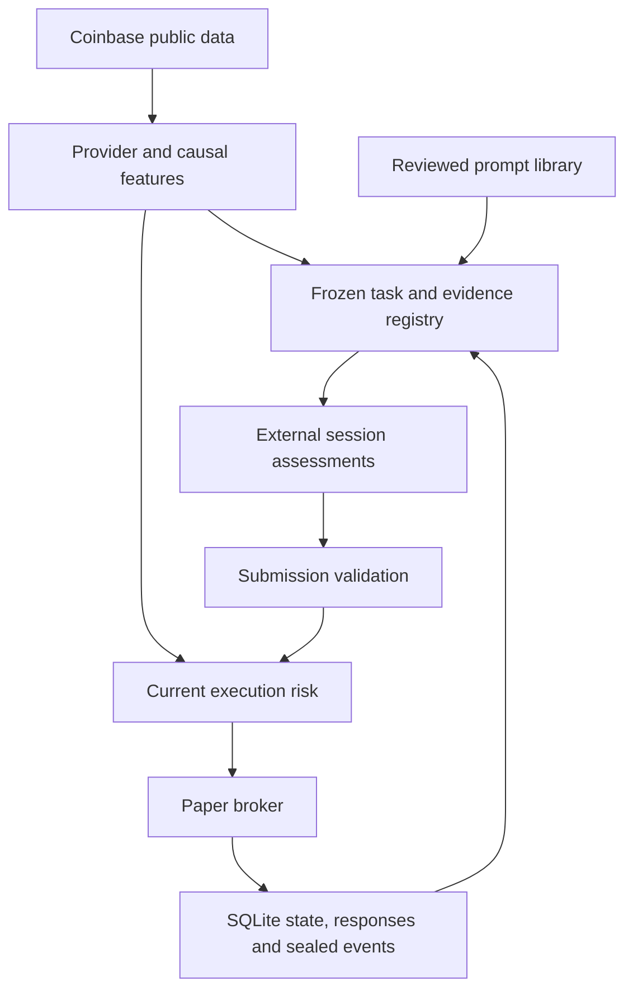

# Architecture

> Default backend: [multi-token portfolio](portfolio.md). The detailed legacy
> procedures below apply to explicit legacy accounts unless stated otherwise.

## Control and data paths

Alladin separates external reasoning from deterministic account mutation. HTTP,
MCP, and CLI invoke the same `Service` path. The backend does not execute model code.

The observation worker continues position protection during external reasoning;
it does not create agents.

## Components

| Module | Responsibility |
|---|---|
| `instruments.py` | Product-agnostic public catalog, canonical identity, metadata, research books and truthful capability reporting; independent of legacy account execution |
| `providers.py` | Coinbase candles, full observations, book-only exit marks |
| `transport.py` | Bounded HTTPS, retries, response limits, failure phases |
| `models.py` | Validated data, proposals, portfolio, configuration |
| `features.py`, `strategies.py` | Causal indicators and advisory candidates |
| `finance.py` | Evidence registry, economics, and cost stress |
| `prompts.py` | Versioned prompt loading; path, size, and hash checks |
| `agents.py` | Contracts, references, consensus, and rules baseline |
| `external.py` | Material account binding and task validity |
| `risk.py` | Safety gates, economics, sizing, circuit breakers |
| `broker.py` | Paper accounting, observed exits, trailing protection |
| `engine.py` | Durable command state machine and execution orchestration |
| `storage.py` | Transactions, idempotency, events, hash-chain verification |
| `runtime.py` | Worker lease, health, backoff, interruption |
| `server.py`, `mcp_server.py`, `dispatch.py` | HTTP, MCP, shared dispatch |
| `client.py` | Authenticated HTTP consumer without automatic mutation retries |
| `research.py`, `validation.py`, `evaluation.py` | Replay/export, chronological evaluation, observed statistics |
| `demo.py`, `diagnostics.py` | Bounded observation and read-only source checks |

## Atomic boundary

Market I/O happens before the write transaction. Inside `BEGIN IMMEDIATE`, the
service reloads state, rechecks authority, applies an authorized change, records
its event, and stores the response together. Provider failure before this boundary
cannot create a partial fill.

An idempotency lookup precedes collection and is checked again transactionally.
A committed response survives restart/client timeout and can be returned without
another fetch or execution. Reusing a key with different content is rejected.

SQLite uses WAL and `synchronous=NORMAL`: atomicity and process-crash consistency,
not maximum OS/power-loss durability. The most recent committed transaction can
be lost in a power failure; recovery depends on idempotent repetition. Persistent
storage and consistent backups are still required.

## Frozen analysis, current execution

Concurrent preparations coalesce into one valid task. `context_sha256` binds account
authority; `evidence_sha256` binds reviewed observations. Reuse does not renew expiry.

The material hash includes configuration/mode, permissions, pending activity,
execution-check ownership, cash, position identity/size, fills, fees, and halt state.
It excludes observational changes: new candles, marks, curve, last HOLD, peak
observations, and trailing-stop movement. Current execution checks these risk values.

Submission reconstructs the original context and reproduces its hash. Old reports
are not relabeled as new analysis. Entry also obtains current closed risk features
and a fresh full Coinbase snapshot. Audit fields distinguish `analysis_as_of`,
`risk_bar_closed_at`, and `execution_snapshot`.

Tasks last `min(300, 2 × timeframe_seconds)` seconds. A task can cross a bar boundary,
but cannot bypass expiry, material changes, current risk, or the entry-price guard.
Excessive deviation retires the task with `reprepare_required`, allowing fresh preparation.

## Concurrency

- HTTP accepts one mutating command at a time; overlaps return `503 command_busy`.
  Reads remain available; `halt` has an expedited path.
- Worker and consumer can collect observations independently. SQLite serializes
  short commits, and authority is checked again after I/O.
- A POSIX advisory lease prevents a second cooperative worker for the same
  resolved database path. It is not distributed consensus.
- Parallel preparers receive the same valid task; one task cannot be consumed twice.
- Before an approved entry on a flat account, newer observed closed history is
  synchronized so the next tick does not invent an open-position feed gap.

## Position protection and gaps

Live-data processing never uses a candle preceding entry to invent a retrospective
stop. Current marks handle between-candle protection while polling is active.
Recovery from an unobserved gap with exposure/pending activity needs a verified
current mark, flattens there, and latches a feed-gap halt. A flat account can rewarm
from contiguous recent history without inventing skipped-time trades.

HOLD fetches no execution quote and applies no mark. CLOSE needs a fresh book,
not unrelated candles/trades/volume or an entry-only deviation check.

## Audit boundary

Each seal hashes the previous digest plus event sequence, timestamp, kind, and
payload. This detects alteration/removal relative to an intact or independently
retained head. It is not a signature: a database administrator can rewrite a whole
chain. Retain independent heads and consistent backups for stronger evidence.

No component signs transactions, connects wallets, collects RPC data, loads remote
reasoning models, or submits real exchange orders.
